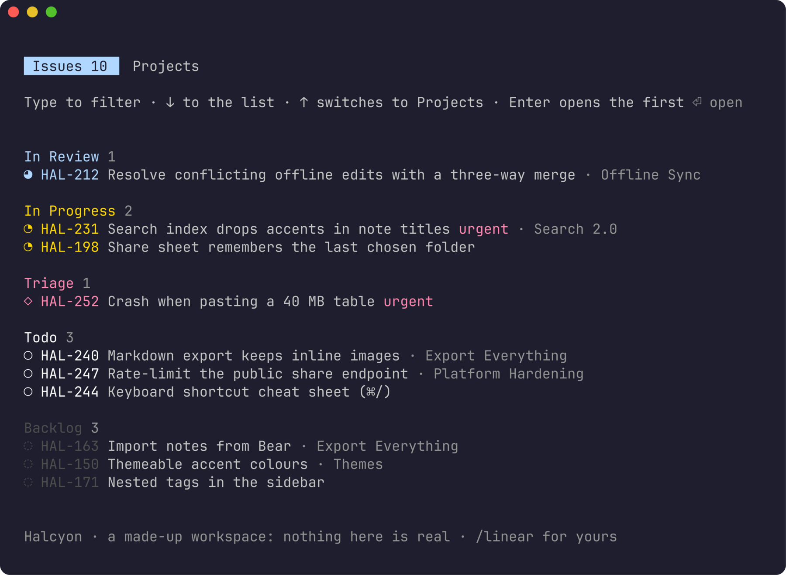
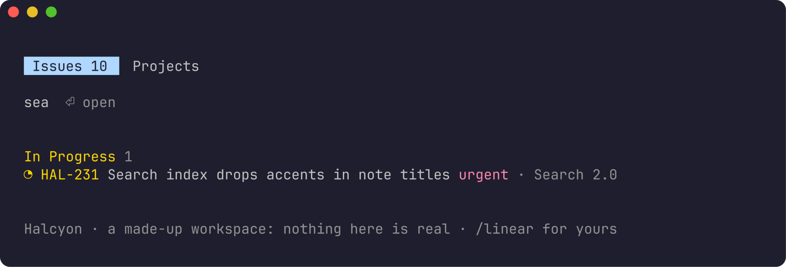
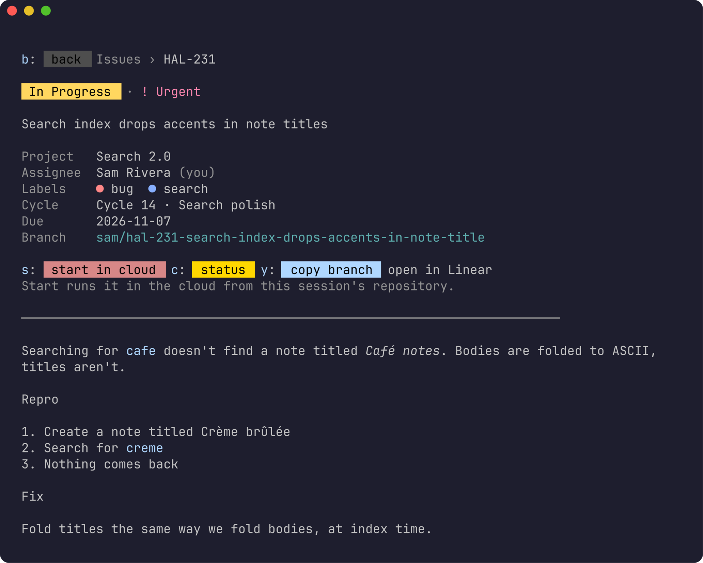
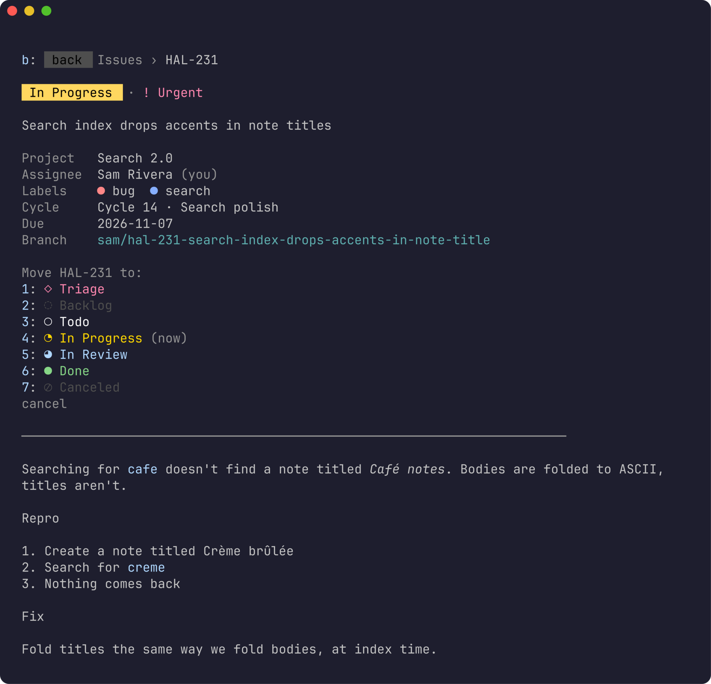
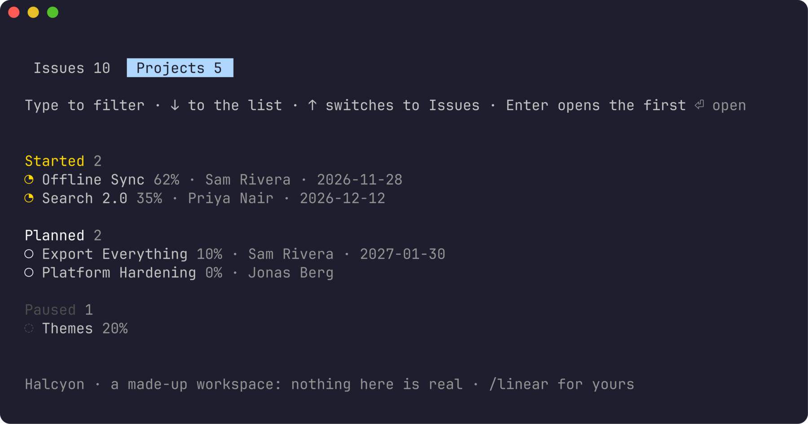
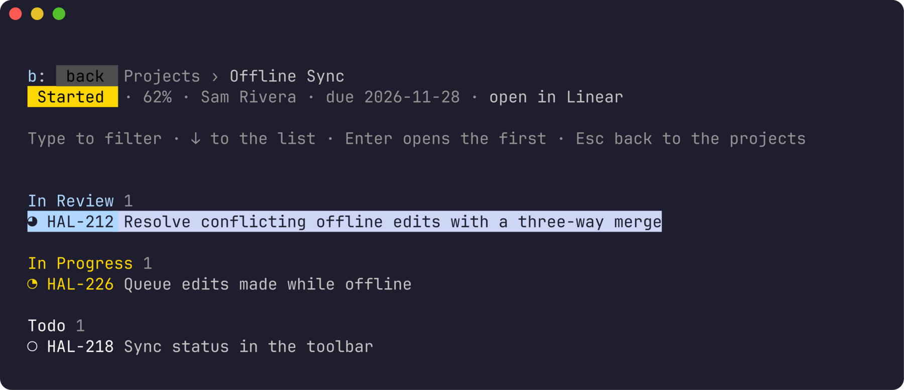

# claude-mods-linear

**Your Linear issues and projects in a pane beside Claude Code.** See what
you're working on, read an issue, change its status, and start it as a Claude
Code cloud session, without leaving the conversation.



- **My issues** grouped by status, In Review and In Progress first, in
  Linear's status marks and colours, urgent ones marked and their projects
  beside them.
- **Type to filter**, then ↓ into the list and Enter to open.
- **An issue's screen** laid out as
  [herdr-linear](https://github.com/mrolafsson/herdr-linear)'s: the status
  in Linear's colour for it, priority, project, assignee, labels in their
  colours, cycle, due date, branch, and the description as Markdown.
- **Change status** from the team's own workflow.
- **Start** an issue: it's yours and In Progress, and a Claude Code cloud
  session takes it on, told to branch from `origin/main` and open a draft
  pull request.
- **Projects**: by state, with progress, lead and target date; each opens on
  its own screen with its open issues.
- **Several workspaces**, one sign-in each, switched with a press.
- **Try it without an account**: `/linear demo` is a made-up workspace.
- **As big as the layout allows**, and in Claude Code's theme colours.
- Signs in with **OAuth**: no API keys to paste.

A Claude Code mod: a plugin that draws in Claude Code's own interface, in a
terminal session. It's a separate, smaller thing from herdr-linear, the herdr
plugin it takes its look from: they share no code.

**Contents:** [Requirements](#requirements) · [Install](#install) ·
[Try it without an account](#try-it-without-an-account) · [Sign in](#sign-in) ·
[Use](#use) · [Start](#start) · [Where it opens](#where-it-opens) ·
[Privacy and security](#privacy-and-security) · [Uninstall](#uninstall) ·
[Development](#development) · [License](#license)

## Requirements

- [Claude Code](https://claude.com/claude-code) in a terminal. The pane draws
  there; the iPhone and iPad apps don't show mod panes, and a `/linear` typed
  there arrives as text.
- A Linear account, for anything but the demo.
- For **Start**: `claude --cloud` working where you run Claude (a Claude
  account with cloud sessions), and `script`, which macOS and Linux have.

## Install

At the prompt of a Claude Code session:

```
/plugin install linear --marketplace mrolafsson/claude-mods-linear
```

Answer `y` to add the marketplace, then pick a scope: **user**, for every
session. Or from a shell:

```sh
claude plugin install linear --marketplace mrolafsson/claude-mods-linear
```

`/plugin update` brings a newer version.

## Try it without an account

`/linear demo` opens the pane on *Halcyon*, a made-up notes-app company with
a team, five projects and a dozen issues. Everything works: statuses change,
issues start. Nothing is real: the demo never contacts Linear, never reads
your sign-in, and starts no cloud session; it says what Start would have
done. `/linear` goes back to your own workspaces.

It's also how the screenshots in this README are made. See
[Screenshots](#screenshots).

## Sign in

Type `/linear`. The first time, it asks you to sign in:

1. Open **Approve in Linear**, or copy the link (`y`) to a browser anywhere,
   and approve. Linear asks which workspace.
2. Linear then sends the browser to a `localhost:47821` page, which may not
   load: it needn't, say when Claude runs on another computer over SSH. Copy
   that page's whole address, Tab to the box in the pane, paste it, and press
   Enter.

Your issues come up. **+ workspace**, under the list, signs in to another;
**sign out** forgets one on this computer.

## Use

### My issues

The pane opens on your open issues, the cursor in the filter. Type to narrow
them down: the key, the title, the project and the status all count.



**↓** goes into the list; **↑ ↓** move through it and **Enter** opens an
issue. **Enter** in the filter opens the first match. The list draws what fits
and follows you through it, saying how many more are above and below.

### An issue



Its status in Linear's colour for it, then everything Linear knows about it:
project, assignee, labels, cycle, due date and branch, then the description.
The letters act: **s** starts it, **c** changes its status, **y** copies its
branch, **b** goes back (as does Esc). **open in Linear** is a link.

### Changing status



**c** lists the team's statuses, in the order work goes through them, the
current one marked. Pick one with the arrows or its number. Esc closes the
list and keeps the issue.

### Projects

**↑** from the filter switches between **Issues** and **Projects**.



Open projects by state, started first, each with its progress, lead and
target date. **Enter** opens one:



Its state, progress, lead and due date over its open issues. An issue opened
from here says where it came from (**Projects › Offline Sync › HAL-212**), and
Esc goes back a step at a time: the issue, the project, the projects.

### All keys

| Key | Does |
| --- | --- |
| type | filter; Enter opens the first match |
| ↓ | from the filter into the list |
| ↑ ↓, Enter | through the list; open the issue or project |
| ↑ from the filter | switch between Issues and Projects |
| s, c, y, b | on an issue: start, status, copy branch, back |
| 1–9 | on the status list: that status |
| Esc | clear the filter; back from an issue or a project; close |

The mouse works too: a click opens a row, a tab or a link.

## Start

**s** on an issue, or **start in cloud**:

1. The issue becomes yours and In Progress (your team's first started
   status).
2. A Claude Code cloud session starts on it, from **the repository the Claude
   session is in**: the issue's screen says which. It's handed the issue's
   title, link and description, and told to branch from GitHub's
   `origin/main` with Linear's branch name, follow the repository's
   CLAUDE.md, add tests, and open a draft pull request referencing the issue.
3. The pane shows the session's link (**l** copies it); it's in your
   sessions at claude.ai/code and in the Claude app too.

So open the pane from a session in the issue's repository. `claude --cloud`
takes your local branch with it, which is why the session is told to start
from `origin/main`. Cloud sessions push `claude/…` branches, whatever name
they're given; the pull request's description links it to the issue.

## Where it opens

Claude Code decides where a pane goes, by your renderer:

- `/tui fullscreen`: docked beside the conversation, up to 45% of the width.
- `/tui default`: above the prompt, as tall as the layout spares.

The pane asks for all the room it can get, and a size you drag it to wins.

## Privacy and security

- Signs in with Linear's OAuth (authorization code with PKCE, no client
  secret), using herdr-linear's public client. Access is `read,write`.
  Revoke it any time in Linear's settings, among your authorized
  applications.
- The tokens are kept in Claude Code's plugin store on that computer
  (`~/.claude/plugins/store/`), a file only you can read, and refreshed when
  they expire. **sign out** forgets a workspace's.
- The pane talks to `api.linear.app` and `linear.app` alone. It runs one
  program: `claude --cloud` (through `script`, which gives it the terminal it
  needs), and only when you press **start in cloud**.
- The demo contacts nothing and runs nothing.

## Uninstall

**sign out** for each workspace, then:

```
/plugin uninstall linear
```

Revoke the app in Linear's settings too, if you like.

## Development

From a checkout, start Claude Code with the mod loaded from it:

```sh
claude --plugin-dir .
```

Run the tests, which drive the pane against a stand-in Linear:

```sh
claude plugin test .
claude plugin validate .
```

### Screenshots

```sh
sh scripts/screenshots.sh           # rewrites docs/images/
```

Starts Claude Code with the mod in a hidden tmux window, opens `/linear demo`,
walks through the screens with key presses and captures each one;
`scripts/crop-pane.py` cuts the pane out, and
[freeze](https://github.com/charmbracelet/freeze) draws it. Only the demo's
made-up data is ever in a picture, and `/linear` runs in the mod: nothing
reaches the model. Needs tmux, freeze, rsvg-convert with the JetBrains Mono
font, and python3.

## License

MIT
